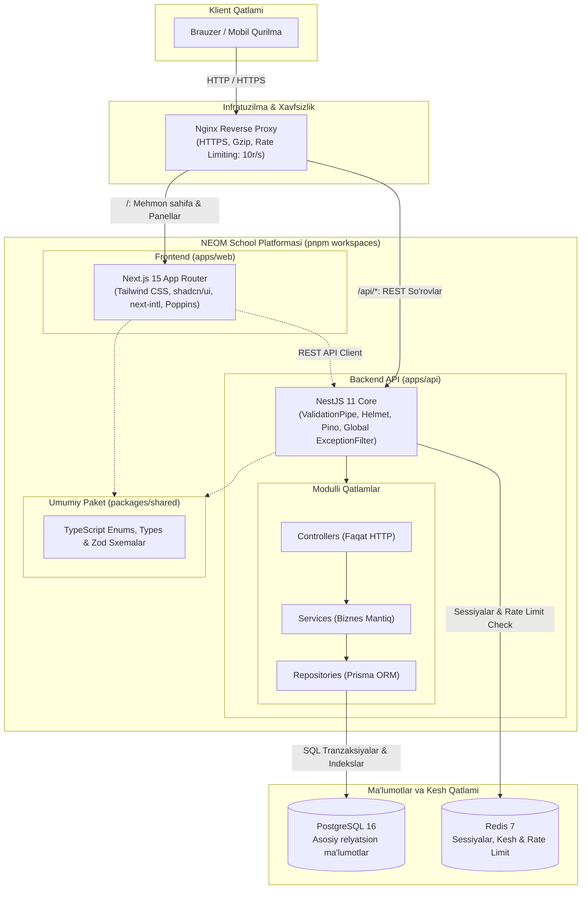

# NEOM School — Platforma Poydevori (Foundation)

> **NEOM School** zamonaviy xususiy maktab boshqaruv platformasining poydevori: modulli monolit (modular monolith) arxitekturasi, Prisma + PostgreSQL ma'lumotlar bazasi, Redis kesh & rate limiting, NestJS API, Next.js 15 App Router veb-ilovasi va Nginx teskari proksisi.

---

## 🏛️ 1. Arxitektura Sxemasi

Platforma **Modular Monolith** tamoyili asosida qurilgan. Har bir modul (auth, users, classes, students, attendance, posts, media, audit, health) qat'iy ravishda o'z qatlamlariga bo'lingan va kelajakda kerak bo'lsa mustaqil mikroservisga ajratilishi mumkin:
- **Controller:** Faqat HTTP/REST so'rovlarni qabul qilish va javob qaytarish.
- **Service:** Sof biznes mantiq va qoidalar.
- **Repository:** Ma'lumotlar bazasiga murojaat qiladigan yagona nuqta (Prisma orqali). Parollar hech qachon tashqi qatlamga yoki logga chiqmaydi.



---

## ⚡ 2. Nega aynan bu stek tanlandi?

1. **Node.js 22 LTS (Non-blocking I/O):**
   Maktabda ertalabki soatlarda (08:00 - 08:30) yuzlab o'qituvchilar bir vaqtning o'zida davomat kiritadi. Node.js'ning hodisalarga asoslangan (event-driven), bloklanmaydigan arxitekturasi minglab bir vaqtli ulanishlarni qo'shimcha resurs sarflamasdan tezkor qabul qiladi.
2. **Redis 7 (Xotiradagi kesh va Rate Limit):**
   Ko'p so'raladigan umumiy ma'lumotlar (kunlik davomat hisoboti, maktab statistikasi, mehmon sahifadagi yangiliklar) Redis'da keshlanadi, bu esa PostgreSQL bazasidan og'ir yuklamani olib tashlaydi va DDoS hujumlariga qarshi global limitni kafolatlaydi.
3. **PostgreSQL 16 (Indekslar va Tranzaksiyalar):**
   Davomat — bu yozuv-ko'p (write-heavy) yuklama. PostgreSQL ACID tranzaksiyalari, qat'iy constraint'lar (`unique(studentId, date)`, `unique(homeroomTeacherId, academicYearId)`) va optimallashgan indekslar (`[classId, date]`, `[date, status]`) bilan ma'lumotlar yaxlitligini ta'minlaydi.
4. **Stateless API va Gorizontal Kengayish (Horizontal Scalability):**
   NestJS API stateless tarzda ishlab chiqilgan (sessiya holati server xotirasida emas, balki Redis/JWT'da saqlanadi). Shu sababli, yuklama oshganda Docker yoki Kubernetes orqali bir nechta `api` konteynerini istalgancha ko'paytirish mumkin.

---

## 📁 3. Monorepo Tuzilmasi

```
neom-school/
├── apps/
│   ├── api/                     # NestJS API (Port: 4000)
│   │   ├── src/
│   │   │   ├── common/          # Guards, decorators, filters, interceptors, pipes, config
│   │   │   ├── modules/         # auth, users, classes, students, attendance, posts, media, audit, health
│   │   │   ├── app.module.ts
│   │   │   └── main.ts
│   │   ├── prisma/              # schema.prisma, seed.ts
│   │   └── Dockerfile
│   └── web/                     # Next.js 15 App Router (Port: 3000)
│       ├── src/
│       │   ├── app/
│       │   │   ├── (public)/    # Mehmon sahifa (Landing)
│       │   │   ├── kirish/      # Tizimga kirish sahifasi
│       │   │   └── panel/       # ustoz, zavuch, direktor panellari
│       │   ├── components/      # ui/ (Button, Input, Card, StatusButton...), layout/
│       │   ├── lib/             # api-client, i18n, utils
│       │   └── styles/          # tokens.css, globals.css
│       └── Dockerfile
├── packages/
│   └── shared/                  # Umumiy Zod sxemalar, enumlar va tiplar
├── infra/
│   ├── nginx/                   # Nginx reverse proxy va gzip/rate limit sozlamalari
│   └── docker/                  # Multi-stage Dockerfile'lar
├── docker-compose.yml           # Postgres, Redis, API, Web, Nginx
├── docker-compose.override.yml  # Lokal dev hot-reload sozlamalari
├── Makefile                     # make up, make seed, make test buyruqlari
├── .env.example                 # Barcha konfiguratsiya o'zgaruvchilari
└── README.md
```

---

## 🎨 4. Frontend Dizayn Tizimi (Design Tokens)

Tizim biriktirilgan Figma/HTML dizayniga aynan mos ranglar va o'lchamlar asosida shakllantirilgan:

- **Asosiy ranglar:**
  - `primary`: `#0c3b7c`
  - `primary-dark`: `#0c2f66`
  - `accent (to'q sariq)`: `#f78b2d` (ustidagi matn `#1a1204`)
  - `accent-text`: `#8a3d00`
  - `background`: `#f4f7fc`
  - `surface`: `#ffffff`
  - `border`: `#e1e8f3` (input border: `#b9c8e2`)
  - `text`: `#0b2a5b`
  - `muted`: `#4a5f82`
- **Davomat holatlari (Rang + Matn):**
  - **Keldi:** Yashil (`#d9f3e1` / `#0d4a22`, chegara: `#1c7a3c`)
  - **Kelmadi:** Qizil (`#fde0e0` / `#7a1410`, chegara: `#b3261e`)
  - **Sababli:** Ko'k (`#dbe9ff` / `#0c3b7c`, chegara: `#1f5fc4`)
  - **Kechikdi:** Sariq (`#fff3c2` / `#5c4400`, chegara: `#a67c00`)
- **Shrift va o'lchamlar:**
  - Shrift: **Poppins** (`next/font/google`, 400, 500, 600, 700)
  - Karta radiusi: `16px`
  - Tugma va input radiusi: `10px`, balandligi kamida `44px`
  - Kartada 1px border va 20px padding

---

## 🚀 5. Ishga tushirish qadamlari

### Usul 1: Docker Compose bilan (Tavsiya etiladi)

1. Muhit parametrlarini nusxalash:
   ```bash
   cp .env.example .env
   ```

2. Barcha servislarni ishga tushirish:
   ```bash
   docker compose up -d --build
   ```

3. Ma'lumotlar bazasini tayyorlash va seed qilish:
   ```bash
   # Konteyner ichida migratsiya va seed
   docker compose exec api npx prisma migrate deploy
   docker compose exec api npx ts-node prisma/seed.ts
   ```

4. Servislar:
   - **Veb interfeys:** [http://localhost](http://localhost) (yoki [http://localhost:3000](http://localhost:3000))
   - **Backend API:** [http://localhost/api](http://localhost/api) (yoki [http://localhost:4000/api](http://localhost:4000/api))
   - **Salomatlik tekshiruvi:** [http://localhost/health](http://localhost/health)
   - **Swagger API Docs (Dev):** [http://localhost/docs](http://localhost/docs)

---

### Usul 2: Lokal muhitda (pnpm bilan)

1. Bog'liqliklarni o'rnatish:
   ```bash
   pnpm install
   ```

2. Umumiy paketni qurish:
   ```bash
   pnpm --filter "@neom/shared" build
   ```

3. Prisma klientini generatsiya qilish:
   ```bash
   pnpm --filter "@neom/api" prisma:generate
   ```

4. Lokal dev serverlarni ishga tushirish:
   ```bash
   pnpm dev
   ```

5. Testlarni ishga tushirish:
   ```bash
   pnpm test
   ```

---

## 🔐 6. Seed Foydalanuvchilari (Test hisoblari)

Parollar `.env` faylidagi `SEED_*_PASSWORD` parametrlaridan olinadi:
- **Direktor:** login: `director`
- **Zavuch:** login: `zavuch`
- **Ustoz 1 (1-A rahbari):** login: `teacher1`
- **Ustoz 2 (2-A rahbari):** login: `teacher2`
- **Ustoz 3 (11-A rahbari):** login: `teacher3`
